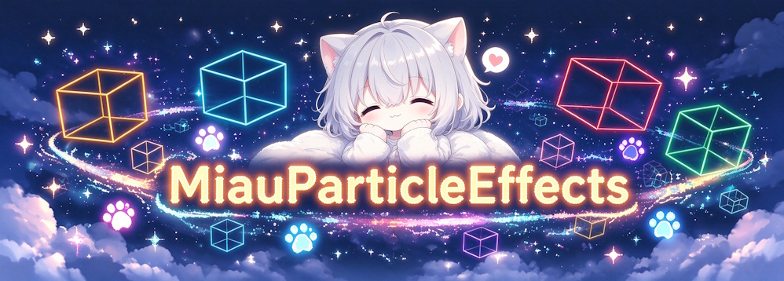
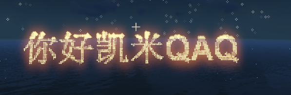
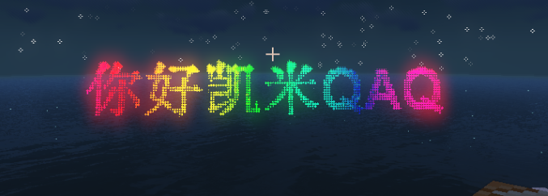

<div align="center">

<!-- LOGO Made By AI-->


# MiauParticleEffects

**一只喵喵，把红石音乐泼洒成漫天流光。**

将音符盒与粒子特效绑定，实现视觉盛宴 + 红石音乐的双重体验。

[English](README.md) · **简体中文**

[](#-运行需求)
[](#-运行需求)
[](#-运行需求)
[](LICENSE)
[](https://github.com/omninbs/MiauParticleEffects/stargazers)
[](https://www.bilibili.com/video/BV1y1n861ER4/)

</div>

---

## 📖 目录

- [✨ 项目简介](#-项目简介)
- [🚀 运行需求](#-运行需求)
- [📦 安装方式](#-安装方式)
- [🎆 功能特性](#-功能特性)
- [📖 命令手册](#-命令手册)
- [💡 使用示例](#-使用示例)
- [⚙️ 配置文件](#️-配置文件)
- [🖼️ 截图](#️-截图)
- [📚 文档](#-文档)
- [🤝 参与贡献](#-参与贡献)
- [📄 许可证](#-许可证)

---

## ✨ 项目简介

**MiauParticleEffects** 是一款面向**红石音乐**的 Minecraft Java（Fabric）模组。它让每一个被激活的**音符盒**都化作一缕流光：

- 🧱 **粒子歌词** —— 用**粒子当作像素**渲染文字，支持丰富的入场/出场动画。
- 💥 **粒子特效** —— 空心正方体、立体三角、宇宙爆炸、水波。
- 🎵 **音符盒弹力球** —— 一颗带拖尾的**弹力球彗星**，在音符间跳跃起舞。
- 🌈 **四种颜色模式** —— 纯色、静态渐变、流动彩虹渐变、彩虹循环。

粒子写成的歌词 + 跟随红石旋律的视觉化 → 一块屏幕之上，**音乐与光芒合二为一**。

---

## 🚀 运行需求

| 项目 | 版本 |
|---|---|
| Minecraft | **1.21.1 / 1.21.4 / 1.21.8 / 1.21.11 / 26.2**（多版本，一套源码） |
| 装载器 | Fabric Loader **>= 0.16.0** |
| API | Fabric API（对应 MC 版本最新版） |
| Java | **21**（1.21.x）/ **25**（26.x） |

> [!IMPORTANT]
> **客户端与服务端均需安装**本模组。专用服务器需安装以检测音符盒并广播显示事件。

---

## 📦 安装方式

1. 为你的 Minecraft 版本安装 [Fabric Loader](https://fabricmc.net/use/)。
2. 将 `MiauParticleEffects-<版本>.jar` 放入 `mods/` 文件夹。
3. 安装对应版本的 [Fabric API](https://modrinth.com/mod/fabric-api)。
4. 启动游戏，输入 `/mpe` 或 `/miauparticleeffects` 查看所有命令。

---

## 🎆 功能特性

### 🟦 粒子歌词（文字显示）

```text
/mpe text "<歌词内容>" <x> <y> <z> [选项]
```

- 每个字符都会被栅格化为**粒子像素**（支持 `§` 颜色代码）。
- 入场/出场动画：`slide` 滑入滑出、`scale` 缩放、`spacing` 聚散、`clarity` 清晰度，附加 `fade` 淡入淡出。
- 全局 `density` 控制粒子间距（质量 ⇄ 粒子数量）。

### 🔊 粒子特效

```text
/mpe effect <cube|tetra|explosion|wave> <x> <y> <z> [选项]
```

| 类型 | 说明 |
|---|---|
| `cube` | 空心正方体线框 |
| `tetra` | 空心正四面体 |
| `explosion` | 向四面迸发的宇宙爆炸 |
| `wave` | 不断扩散的水波（速度可调） |

### 🎵 音符盒弹力球（生成器联动）

由**生成器**在每条链式结构起点放一个脉冲命令方块，启动时把整条时间轴一次性交给模组：

```text
/mpe noteblock chain ~~~ 3,0,0,10|6,0,0,8|9,0,0,8|12,0,0,16| curve=arc height=3 trail=24
```

- **纯时间轴驱动** —— 模组不再检测音符盒发声、也不反推红石走线；每条链的顺序与间隔由生成器直接给出（`x,y,z,delay`，`delay` 单位为游戏 tick），**第一遍播放就与歌曲完全对齐**。
- **一链一球** —— 一条链 = 一颗带彗尾的弹力球，落点固定为音符盒上表面中心，链与链之间互不干扰，不会串轨或卡死。
- **60FPS 轨迹** —— 位置按渲染帧（约 60FPS）重新求值，曲线连续、没有多边形折线感；拖尾按弧长加密补点，形成平滑彗尾。
- **球体外观** —— 亮核 + 球面外壳光点构成一颗发光小球，尾部由粗到细，像彗星也像《滚动的天空》里的球。
- **动态跳跃高度** —— `height` 只是**上限**：球会按这一跳的水平距离与间隔在 `[H-2, H]` 之间自动取值（`H ≤ 2` 时固定为 `H`）。
- 同一锚点重复执行 = 重置该链并从头重播。

**音符盒触发特效**（可选）：开启后，每个音符盒被触发的瞬间，会在它所在位置播放一次指定特效。

```text
/mpe noteblock triggereffect effect wave ~ ~2 ~ duration=4 speed=8 enter=3 exit=0 size=2.8 color=#11FFFF
/mpe noteblock triggereffect on
```

参数语法与 `/mpe effect` 完全一致，其中 `~~~` 代表**目标音符盒方块本身**（`~ ~2 ~` = 音符盒正上方 2 格）。

### 🎨 一种命令，四种颜色

```text
color=#FFD700                        # 纯色（可带透明度）
gradient=#FF0000,#00FF00,#0000FF     # 静态渐变色
gradient=rainbow                     # 流动的彩虹渐变
color=rainbow                        # 整体颜色随时间循环（彩虹色）
```

---

## 📖 命令手册

进入游戏输入/mpe help就可以啦~
才不是我懒呢。

特效大部分都得配合我的 MiauRedstoneMusic生成器 才能很好发挥哦。

[MiauNoteBlock](https://github.com/omninbs/MiauNoteBlock) 负责NBS编曲，完成后导出歌曲数据。
[MiauRedstoneMusic](https://github.com/omninbs/MiauRedstoneMusic) 负责生成结构，并且自动生成命令方块调用粒子特效，包括歌词！
MiauParticleEffects 就是现在的项目喵，它能绘画满天星空送给你！

---

## 💡 使用示例

```text
/mpe text "§4哈§6吉§b咪" 100 64 100 scale=1.2 color=#FFD700 in=slide:up,scale:enlarge fade=in
/mpe text "歌词" 100 64 100 gradient=#FF0000,#00FF00 move=0,2,0,40,linear
/mpe effect cube 100 64 100 size=2 color=#00FFFF rotate=0,1,0,3
/mpe effect explosion 100 64 100 size=6 gradient=#FF4500,#FFFFFF
/mpe effect wave 100 64 100 size=5 speed=3 color=#00FF00

/mpe noteblock chain ~~~ 3,0,0,10|6,0,0,8|9,0,0,8|12,0,0,16| curve=arc height=3 color=rainbow
/mpe noteblock triggereffect effect wave ~ ~2 ~ duration=4 speed=8 size=2.8 color=#11FFFF
/mpe noteblock triggereffect on
```

---

## ⚙️ 配置文件

首次启动会自动生成 `config/miauparticleeffects.json`：

```json
{
  "density": 0.1,
  "autoclear": false,
  "defaultScale": 1.0
}
```

| 键 | 说明 |
|---|---|
| `density` | 粒子采样间距（方块），越小越清晰、粒子越多 |
| `autoclear` | 自动让旧文字先退场 |
| `defaultScale` | 默认字形高度（方块） |

---

## 🖼️ 截图

<table>
  <tr>
    <td></td>
    <td></td>
    <td></td>
  </tr>
</table>

截图很难展现内容，而且还麻烦，猫猫喜欢偷懒喵！更多请看【红石音乐《失眠》| 纯原版】 https://www.bilibili.com/video/BV1y1n861ER4/?share_source=copy_web&vd_source=3e96416363504f8b52218590d3a13075

---

## 📚 文档

- [中文使用教程](docs/USAGE_CN.md)
- [English usage guide](docs/USAGE.md)
- [English README](README.md)

---

## 🤝 参与贡献

欢迎提 [Issue](../../issues) 或 [PR](../../pulls)，一起完善这个模组！

请尽量附上：Minecraft / Fabric Loader / Fabric API 版本、使用的完整命令、相关日志或崩溃报告、显示问题的截图或短视频。

**ps：大约 80% 的代码是 AI 写的喵，手搓这么大个项目会累死喵喵我的，所以选择了用 AI 喵！**

---

## 📄 许可证

基于 [Fabric](https://fabricmc.net/) 与 Fabric API 构建，灵感来源于红石音乐的魅力。

许可证：[Apache License 2.0](LICENSE)。
