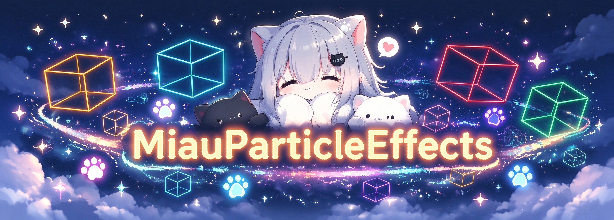
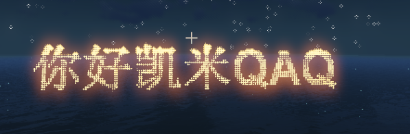
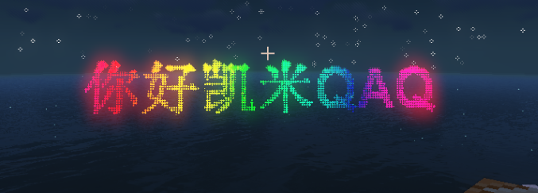
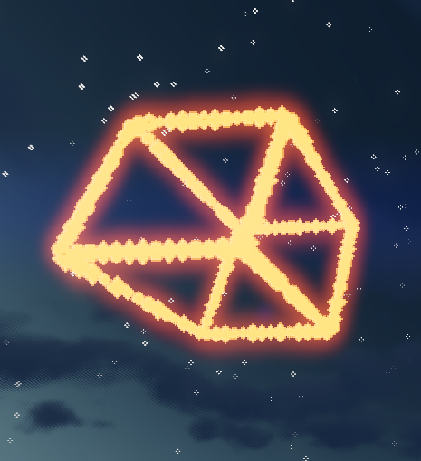

<div align="center">



# MiauParticleEffects

**A little cat turns redstone music into a sky full of light.**

Bind note blocks to particle effects for a visual feast alongside your redstone music.

**English** · [简体中文](README_CN.md)

[](#-requirements)
[](#-requirements)
[](#-requirements)
[](LICENSE)
[](https://github.com/omninbs/MiauParticleEffects/stargazers)
[](https://www.bilibili.com/video/BV1y1n861ER4/)

</div>

---

## 📖 Table of Contents

- [✨ About](#-about)
- [🚀 Requirements](#-requirements)
- [📦 Installation](#-installation)
- [🎆 Features](#-features)
- [📖 Command Reference](#-command-reference)
- [💡 Examples](#-examples)
- [⚙️ Configuration](#-configuration)
- [🖼️ Screenshots](#-screenshots)
- [📚 Documentation](#-documentation)
- [🔭 Roadmap](#-roadmap)
- [🧩 Multi-Version Support](#-multi-version-support)
- [🤝 Contributing](#-contributing)
- [📄 License](#-license)

---

## ✨ About

**MiauParticleEffects** is a Minecraft Java (Fabric) mod built for **redstone music**. It binds note blocks to particle effects so every activated note becomes part of a synchronized visual performance:

- 🧱 **Particle lyrics** — rasterize text into particle pixels with rich entrance/exit animations.
- 💥 **Particle effects** — hollow cubes, tetrahedrons, cosmic explosions, and water ripples.
- 🎵 **Note-block comet** — a bouncing, trailing comet that dances between activated note blocks.
- 🌈 **Color modes** — solid colors, static gradients, flowing rainbow gradients, or cycling rainbow colors.

Particle-written lyrics + a visualizer following your redstone melody → **music and light become one**.

---

## 🚀 Requirements

| Item | Version |
|---|---|
| Minecraft | **1.21.1 / 1.21.4 / 1.21.8 / 1.21.11 / 26.2** (multi-version, one codebase) |
| Loader | Fabric Loader **>= 0.16.0** |
| API | Fabric API (latest for the matching Minecraft version) |
| Java | **21** (1.21.x) / **25** (26.x) |

> [!IMPORTANT]
> Install the mod on **both client and server**. A dedicated server needs it to detect note blocks and broadcast display events.

---

## 📦 Installation

1. Install [Fabric Loader](https://fabricmc.net/use/) for your Minecraft version.
2. Put `MiauParticleEffects-<version>.jar` into your `mods/` folder.
3. Install the matching [Fabric API](https://modrinth.com/mod/fabric-api).
4. Launch the game and run `/mpe` or `/miauparticleeffects`.

---

## 🎆 Features

### 🟦 Particle Lyrics

```text
/mpe text "<lyrics>" <x> <y> <z> [options]
```

- Rasterizes every character into **particle pixels**.
- Supports Minecraft `§` color codes.
- Entrance/exit animations: `slide`, `scale`, `spacing`, `clarity`, plus `fade`.
- Global `density` controls pixel spacing, quality, and particle cost.

### 🔊 Particle Effects

```text
/mpe effect <cube|tetra|explosion|wave> <x> <y> <z> [options]
```

| Type | Description |
|---|---|
| `cube` | Hollow wireframe cube |
| `tetra` | Hollow tetrahedron |
| `explosion` | Cosmic particles radiating in every direction |
| `wave` | Expanding water ripple with controllable speed |

### 🎵 Note-Block Comet

Your **generator** places one pulse command block at the start of each chain and hands the whole
timeline to the mod in one shot:

```text
/mpe noteblock chain ~~~ 3,0,0,10|6,0,0,8|9,0,0,8|12,0,0,16| curve=arc height=3 trail=24
```

- **Pure timeline drive** — the mod no longer listens for note-block sounds or traces redstone wiring; each chain's order and spacing come straight from the generator (`x,y,z,delay`, `delay` in game ticks), so it **lines up with the song on the very first playthrough**.
- **One comet per chain** — every chain owns a single comet with a trailing tail, and it always lands on the top-center of a note block. Chains never interfere, so nothing bleeds or gets stuck.
- **60 FPS trajectory** — the position is re-evaluated every rendered frame (about 60 FPS), so the curve stays continuous with no polygonal look; the trail is resampled by arc length for a smooth comet tail.
- **Ball shape** — a bright core plus shell points on a sphere forms a glowing ball, with a tail that tapers from thick to thin — a comet, and a nod to *Rolling Sky*.
- **Dynamic jump height** — `height` is only a **ceiling**: each hop picks an apex between `[H-2, H]` based on its horizontal distance and delay (`H ≤ 2` keeps it fixed at `H`).
- Re-running on the same anchor resets that chain and replays it from the start.

**Note-triggered effect** (optional): when enabled, every note block fires a chosen effect at its own position the moment it is triggered.

```text
/mpe noteblock triggereffect effect wave ~ ~2 ~ duration=4 speed=8 enter=3 exit=0 size=2.8 color=#11FFFF
/mpe noteblock triggereffect on
```

The arguments follow `/mpe effect` exactly, where `~~~` means **the target note block itself** (`~ ~2 ~` = two blocks above the note block).

### 🎨 Color Modes

```text
color=#FFD700                        # solid (alpha supported)
gradient=#FF0000,#00FF00,#0000FF     # static gradient
gradient=rainbow                     # flowing rainbow gradient
color=rainbow                        # one color cycling through the rainbow
```

---

## 📖 Command Reference

| Command | Description |
|---|---|
| `help [subcommand]` | Show general or subcommand-specific help |
| `density <0.01~1>` | Set persistent pixel sampling density |
| `text "<text>" <x> <y> <z> [options]` | Display text with particles |
| `effect <type> <x> <y> <z> [options]` | Cast a particle effect |
| `noteblock chain <anchor> <notes> [options]` | Send / replay one chain (generator-driven) |
| `noteblock clear [id=<ID>]` | Remove all chains, or one chain by id |
| `noteblock status` | List the chains currently alive |
| `noteblock triggereffect on\|off\|effect <args>` | Note-triggered effect switch and parameters (reuses the `effect` syntax) |
| `clear [all\|text\|effect\|id=<ID>]` | Clear displays |
| `autoclear <on\|off>` | Let old text exit before new text starts |

Run a subcommand without its arguments, or query it directly:

```text
/mpe text          /mpe help text
/mpe effect        /mpe help effect
/mpe noteblock     /mpe help noteblock
```

<details>
<summary><b>⚙️ Common options (<code>text</code> / <code>effect</code>)</b></summary>

```text
scale=1.5 color=#FFD700 towards=45,0,0 duration=100 enter=10 exit=10
delay=0 curve=ease-out in=slide:up,scale:enlarge out=clarity:blur fade=both
move=0,2,0,20,linear id=my-lyric
gradient=#FF0000,#00FF00 gradient=rainbow color=rainbow force=true
```

`force=true` bypasses normal particle distance culling. It is useful for distant displays, but can increase client rendering cost.

</details>

<details>
<summary><b>🎵 Note-block options</b></summary>

```text
# Chain parameters (written into a command block by the generator)
chain ~~~ 3,0,0,10|6,0,0,8|9,0,0,8     # note data x,y,z,delay|... ; delay in ticks
trail=24       # trail length in particles (2~256)
curve=arc      # vertical arc: arc | sine | line (no bounce)
height=3       # maximum jump height (the apex varies dynamically within [H-2, H])
color=rainbow  # solid #RRGGBB or rainbow; gradient=#RRGGBB,#RRGGBB also works
linger=40      # ticks to linger after the last note (-1 = permanent)
force=true     # bypass distance culling

# Note-triggered effect
triggereffect on / off
triggereffect effect wave ~ ~2 ~ duration=4 speed=8 size=2.8 color=#11FFFF
```

</details>

---

## 💡 Examples

```text
/mpe text "§4Burn §6bright §btonight" 100 64 100 scale=1.2 color=#FFD700 in=slide:up,scale:enlarge fade=in
/mpe text "Gradient lyrics" 100 64 100 gradient=#FF0000,#00FF00 move=0,2,0,40,linear
/mpe effect cube 100 64 100 size=2 color=#00FFFF rotate=0,1,0,3
/mpe effect explosion 100 64 100 size=6 gradient=#FF4500,#FFFFFF
/mpe effect wave 100 64 100 size=5 speed=3 color=#00FF00

/mpe noteblock chain ~~~ 3,0,0,10|6,0,0,8|9,0,0,8|12,0,0,16| curve=arc height=3 color=rainbow
/mpe noteblock triggereffect effect wave ~ ~2 ~ duration=4 speed=8 size=2.8 color=#11FFFF
/mpe noteblock triggereffect on
```

---

## ⚙️ Configuration

The mod creates `config/miauparticleeffects.json` on first launch:

```json
{
  "density": 0.1,
  "autoclear": false,
  "defaultScale": 1.0
}
```

| Key | Description |
|---|---|
| `density` | Text sampling density (smaller = sharper, more particles) |
| `autoclear` | Make new text wait for old text to exit |
| `defaultScale` | Default glyph height in blocks |

---

## 🖼️ Screenshots

<table>
  <tr>
    <td></td>
    <td></td>
    <td></td>
  </tr>
</table>

Screenshots can hardly do it justice — watch this:【红石音乐《失眠》| 纯原版】 https://www.bilibili.com/video/BV1y1n861ER4/?share_source=copy_web&vd_source=3e96416363504f8b52218590d3a13075.

---

## 📚 Documentation

- [English usage guide](docs/USAGE.md)
- [中文使用教程](docs/USAGE_CN.md)
- [中文 README](README_CN.md)

---

## 🔭 Roadmap

- [x] Particle text and animations
- [x] Cube, tetrahedron, explosion, and wave effects
- [x] Note-block comet binding (per-track)
- [x] Static gradients and rainbow color modes
- [ ] Integration with the [NoteBlockWeb editor](https://github.com/omninbs/NoteBlockWeb)
- [ ] More languages and particle effects
- [ ] Automatic redstone music detection and effect generation
- [ ] More note-block visualizers such as beat bars and equalizers

---

## 🧩 Multi-Version Support

This project uses [Stonecutter](https://stonecutter.kikugie.dev/) to build **one codebase for multiple Minecraft versions**, with `loom-back-compat` selecting the correct Loom variant (obfuscated vs unobfuscated) automatically. Sources are written against Mojang official mappings.

Supported versions: `1.21.1`, `1.21.4`, `1.21.8`, `1.21.11`, `26.2`.

```text
# Build every version (outputs in versions/<version>/build/libs/)
gradlew build

# Build a single version (switch the active version, then build)
gradlew "Set active project to 1.21.8"
gradlew :1.21.8:build
```

- Per-version dependency coordinates live in `stonecutter.properties.toml`.
- Version differences are handled with Stonecutter conditional comments (`/*? if ... */`) and replacements in `stonecutter.gradle.kts`.
- Switch back to 26.2 before committing: `gradlew "Set active project to 26.2"`.

> [!NOTE]
> **Build prerequisites:** the Gradle daemon must run on **Java 25** (Loom 1.18 requires it). This is handled automatically by `gradle/gradle-daemon-jvm.properties` — Gradle will pick (or download via foojay) a Java 25 JVM for the daemon, regardless of your `JAVA_HOME`. The Java 21 toolchain for the 1.21.x targets is auto-provisioned as well.

---

## 🤝 Contributing

Issues, suggestions, and pull requests are welcome. Please include:

- Minecraft, Fabric Loader, and Fabric API versions
- The exact command used
- A log or crash report when relevant
- A short video or screenshot for rendering issues

Most of the implementation was developed with AI assistance, followed by manual integration and build verification. Contributions and corrections are welcome.

---

## 📄 License

Licensed under the [Apache License 2.0](LICENSE).

Built with [Fabric](https://fabricmc.net/) and the Fabric API. Inspired by the creativity of redstone music.
